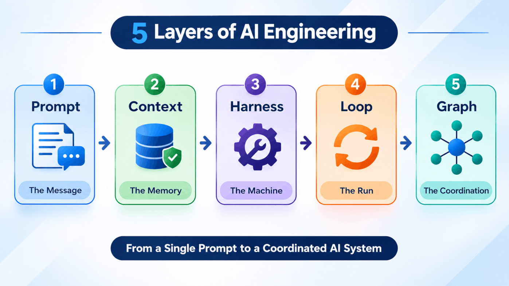
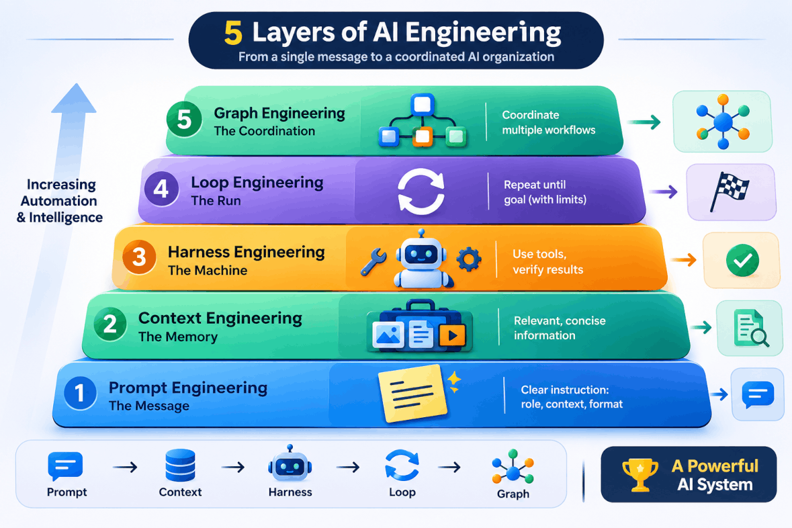
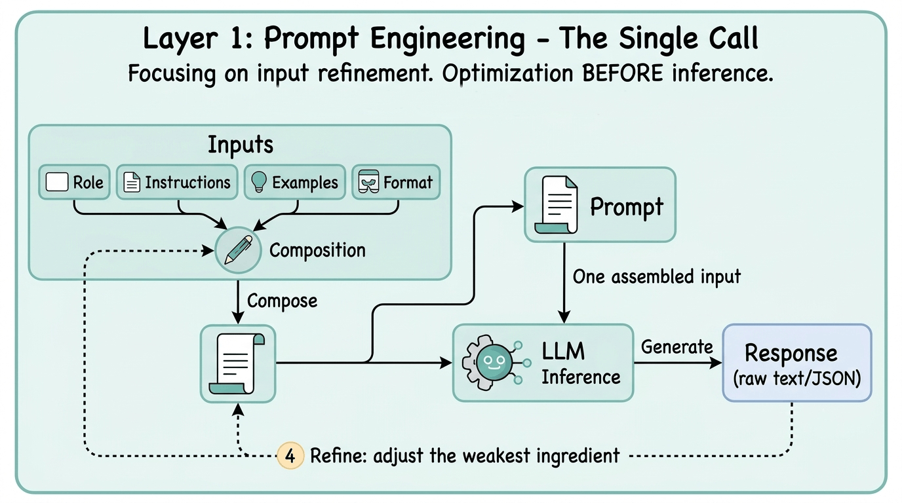
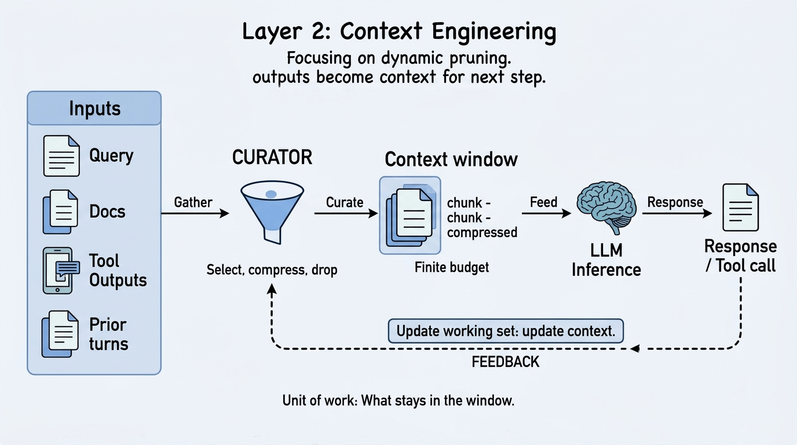
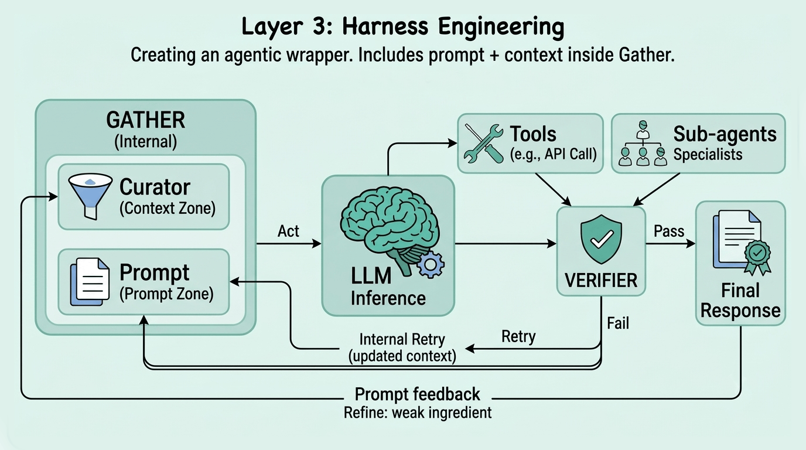
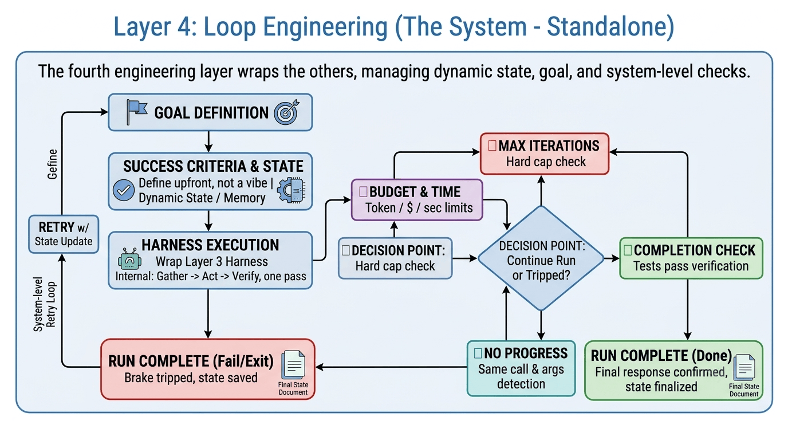
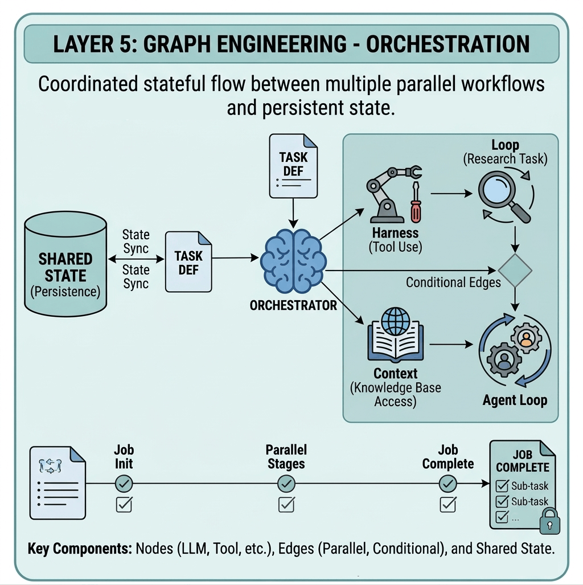

## Hey There, Fellow AI Enthusiast! 👋

Every time I scroll through social media or catch up on tech news, it feels like something new is happening in the AI world. The pace of innovation is incredible! And honestly, even as an AI engineer, keeping up with the constant stream of new tools, concepts, and breakthroughs can sometimes feel overwhelming.

That's why today, I want to unpack something that often confuses developers who are just getting started in the AI world.

We're going to explore Prompt Engineering, Context Engineering, Harness Engineering, Loop Engineering, and Graph Engineering. We'll look at what each concept actually means, how they connect, and what makes them different from one another.

Sound good? Let's dive right in! 🚀

---

## Before We Dive In...

One important thing to remember: these five layers represent a conceptual way of understanding AI engineering, not a formally standardized architecture. In real-world applications, they often overlap, and modern frameworks can handle multiple layers simultaneously.

Here is how each layer works under the hood. 👇

---

## The 5 Layers of AI Engineering

### 1. Prompt Engineering
> Crafting the Message

At the foundation of AI engineering lies Prompt Engineering. This layer is all about designing effective instructions for a language model. It includes defining the role, explaining the task, providing relevant background information, specifying constraints, including examples, and defining the expected output format.

To visualize this, imagine writing a detailed **sticky note for an assistant who suffers from total amnesia**. You must spell out who they are, what you want them to do, what information they need, and how to structure their answer. If the assistant doesn't retain the previous conversation, you must provide the necessary instructions again with the next request! 🤯

Prompt Engineering helps improve the quality, consistency, and reliability of individual model interactions. 

#### Real-World Scenario

Imagine building an AI-powered email classification system.

You want the model to classify incoming emails into categories such as Sales, Support, Billing, and Spam.

Instead of simply asking, "Classify this email," you create a carefully designed prompt that:

* Defines the model's role as an email classification assistant.
* Explains each category and its meaning.
* Provides examples of emails belonging to each category.
* Specifies the expected output as a structured JSON object containing the category and confidence score.

That is Prompt Engineering. Here you improve the instructions until the model consistently produces useful classifications.

#### Tools

When building at this layer in Python, developers commonly rely on tools such as:

* **LangChain Prompt Templates** for creating reusable, parameterized prompts.
* **Jinja2** for dynamic template rendering and prompt construction.
* **Guidance / Instructor** for constrained generation, structured outputs, and validation of model responses.
* **DSPy** for programming LM-based systems and optimizing prompts and examples against evaluation metrics.

---

### 2. Context Engineering
> Managing the Information

Once your prompt is designed, you face a bigger challenge: ensuring the model has access to the right information at the right time.

This is where Context Engineering comes in.

Context Engineering is the discipline of designing and managing everything that goes into a model's context window. This includes system instructions, user messages, conversation history, retrieved documents, tool outputs, and relevant memory.

It involves selecting, organizing, retrieving, compressing, and pruning information so that the model receives the most relevant context without unnecessarily consuming its limited context window.

Think of it like **packing a suitcase for a long trip**. Your suitcase (the context window) has limited space. Instead of dumping your entire wardrobe into the bag, you strategically pick only the clothes that matter for the trip, remove unnecessary items, and vacuum-pack bulky winter coats to save space. 🧳

#### Real-World Scenario

Imagine building an AI customer support assistant for an e-commerce company.

A customer asks:

"Can I return the headphones I purchased last month?"

The model cannot reliably answer this question using its general knowledge alone. It needs access to company-specific return policies and potentially the customer's order details.

A context engineering pipeline might:

* Identify that the question is related to product returns.
* Retrieve the relevant return policy from the company's knowledge base.
* Fetch the customer's order details using an appropriate backend tool.
* Include the relevant policy, purchase date, and product information in the model's context.
* Exclude unrelated documents and unnecessary conversation history.

Now the model has the information needed to provide a meaningful answer.

This is Context Engineering in action: giving the model the right information, rather than simply giving it more information.

#### Tools

Key Python tools and framework modules used for context engineering include:

* **LlamaIndex** for data ingestion, document processing, indexing, and retrieval.
* **ChromaDB / Pinecone / FAISS** for storing and searching vector embeddings to retrieve semantically relevant information.
* **LangChain Retrievers** for fetching relevant documents and injecting them into model context.
* **Conversation history and summarization mechanisms** for maintaining useful information across multiple interactions.
* **RAG (Retrieval-Augmented Generation)** for grounding model responses in external knowledge sources.

---

### 3. Harness Engineering
> Building the Machine

To turn passive text generation into an application capable of taking action, we need something more than prompts and context.

This brings us to Harness Engineering.

An agent harness is the operational infrastructure that connects a language model to its tools, environment, context, and application logic. It manages how the model interacts with external systems and how those interactions are executed, validated, and monitored.

A harness typically handles:

* Tool registration and invocation.
* Authentication, permissions, and approval mechanisms.
* Input and output validation.
* Session and execution state management.
* Error handling and recovery.
* Logging, tracing, and observability.
* Access to external APIs, databases, and execution environments.

Think of it like upgrading from a theoretical recipe reader to **hiring a robot chef in a real kitchen**.

The model is the chef's brain. The harness provides the kitchen, utensils, ingredients, access permissions, and safety mechanisms.

The chef can read the recipe (prompt), inspect the pantry (context), turn on the stove (invoke a tool), and check whether the dish is ready (validate the result).

The harness makes these capabilities available and ensures that actions are executed through a controlled environment. 🤖

#### Real-World Scenario

Imagine building an AI travel booking assistant.

A user says:

"Find me a flight from Pune to Delhi tomorrow morning and book it if the price is below ₹6,000."

The model alone cannot complete this task. It needs a harness that provides controlled access to external systems.

The harness might:

* Expose a flight-search API as a callable tool.
* Validate the source, destination, travel date, and other parameters.
* Authenticate with the flight booking service.
* Retrieve available flights and return the results to the model.
* Check the selected flight's price against the user's budget.
* Require explicit user approval before making a purchase.
* Handle booking errors and record the final transaction status.

Notice that the harness is not responsible for deciding every step of the task. It provides the infrastructure and capabilities that allow the model and application to execute those steps safely.

This is what transforms a basic LLM integration into a system capable of interacting with the real world.

#### Tools

Popular tools and frameworks for constructing this harness layer include:

* **OpenAI Agents SDK / Google ADK** for building agents with tools, execution capabilities, and runtime orchestration.
* **LangChain Tool-calling abstractions** for connecting models with external APIs and application functions.
* **Pydantic** for defining data schemas and validating structured inputs and outputs.
* **Custom Python infrastructure** for authentication, permissions, API integrations, logging, and execution environments.

---

### 4. Loop Engineering
> Controlling the Run

Having tools is great, but how does the system know when to use them again, when to evaluate progress, or when to stop?

Loop Engineering focuses on designing the execution cycle of an agent.

An agent often needs multiple iterations to complete a task. It receives an instruction, reasons about the next action, invokes a tool or performs some operation, observes the result, and decides what to do next.

Loop Engineering defines how this cycle operates, including:

* The conditions for continuing or terminating execution.
* How the agent evaluates whether its goal has been achieved.
* How errors and unsuccessful attempts are handled.
* Maximum iteration and execution limits.
* Timeouts, token budgets, and cost limits.
* Conditions that trigger human intervention.

Imagine programming rules into your robot chef:

"Keep cooking, tasting, and adjusting the seasoning until the soup meets the required quality. But **automatically stop** if you reach five attempts or if your cooking budget runs out."

Without proper execution control, an agent might stop too early, repeatedly perform unsuccessful actions, or consume resources indefinitely. ❌

#### Real-World Scenario

Imagine building an AI coding assistant that fixes bugs in a Python application.

You provide the agent with this task:

"Fix the failing unit tests without breaking existing functionality."

The agent cannot simply generate code once and assume the task is complete. It needs an execution loop.

A typical cycle might look like this:

1. Inspect the existing code and identify the failing tests.
2. Analyze the failure and determine the required changes.
3. Modify the relevant code.
4. Run the test suite.
5. Inspect the test results.
6. If tests still fail, analyze the new errors and attempt another fix.
7. Stop when all required tests pass or when the iteration limit is reached.

You might configure the agent to allow a maximum of five repair attempts and impose a fixed execution budget.

The loop ensures that the agent doesn't simply generate a solution and stop. It can observe the actual results, learn from failures, and make further attempts within predefined limits.

This is Loop Engineering in action.

#### Tools

To engineer stable execution loops in Python, engineers use:

* Standard Python `while` / `for` control flows combined with explicit agent states and termination conditions.
* **CrewAI** for managing task execution, agent iterations, and structured workflows.
* **LangGraph** for implementing stateful execution cycles, conditional transitions, and termination logic.
* **Google ADK LoopAgent** for implementing iterative agent workflows with explicit exit conditions.

---

### 5. Graph Engineering
> Master Orchestration and Coordination

At the top of this conceptual stack is Graph Engineering.

This layer focuses on orchestrating complex workflows involving multiple interconnected steps, execution paths, and potentially multiple agents.

A graph-based architecture typically consists of three fundamental components:

* **Nodes:** Individual units of work, such as invoking an LLM, executing a Python function, retrieving documents, or running a specialized agent.
* **Edges:** Connections that determine which node executes next. They can represent fixed transitions, conditional routing, or parallel execution.
* **State:** Shared data that carries information between nodes as the workflow progresses.

Unlike a simple linear workflow, a graph can support branching, parallel execution, conditional routing, cycles, and coordination between specialized agents.

Picture running a **full restaurant kitchen**.

You have multiple specialized stations: Chef A chops vegetables, passes them to Chef B to cook, who passes them to Chef C to plate. Meanwhile, the Head Chef monitors everything, decides which station needs attention, and determines when a dish is finally ready for the dining room. 🍽️

Not every graph needs multiple agents, though. You can use graph engineering to coordinate ordinary Python functions, model calls, and single-agent workflows as well. Multi-agent coordination is simply one of its more advanced applications.

#### Real-World Scenario

Imagine building an AI-powered market research system.

A user asks:

"Analyze the electric vehicle market in India and prepare a comprehensive report covering competitors, pricing, customer sentiment, and future opportunities."

This is a complex task that requires multiple specialized capabilities. Instead of asking one agent to do everything, you can design a graph that coordinates several specialized agents.

A possible workflow could look like this:

1. **Research Agent:** Collects information about the Indian electric vehicle market.
2. **Competitor Analysis Agent:** Identifies major competitors and analyzes their market positioning.
3. **Pricing Analysis Agent:** Collects and compares vehicle pricing information.
4. **Sentiment Analysis Agent:** Analyzes customer reviews and feedback.
5. **Synthesis Agent:** Combines the findings into a structured market research report.
6. **Quality Check Node:** Validates the report for missing sections, unsupported claims, and inconsistencies.

The graph determines which tasks can run in parallel, where results need to be combined, and what should happen if a particular step fails.

For example, the Competitor Analysis, Pricing Analysis, and Sentiment Analysis agents could work simultaneously after the initial research stage. Their results can then flow into the Synthesis Agent.

This is Graph Engineering in action: coordinating multiple specialized components to accomplish a complex objective.

#### Tools

Frameworks and libraries commonly used for graph-based AI orchestration include:

* **LangGraph** for building stateful, graph-based workflows with nodes, conditional edges, cycles, persistence, and multi-agent coordination.
* **CrewAI (Flows & Crews)** for orchestrating structured workflows and coordinating specialized agents.
* **Google ADK** for composing agents using sequential, parallel, and looping workflow patterns, along with custom orchestration.
* **Microsoft Agent Framework** for building and orchestrating agent-based workflows, building on Microsoft's evolving agent development ecosystem.

---

## Quick Reference Summary

| Layer | The Metaphor | Unit of Work | Popular Python Tools / Frameworks |
| --- | --- | --- | --- |
| **1. Prompt** | The Message / Sticky Note | Instructions for a model call | LangChain, Jinja2, Guidance, DSPy |
| **2. Context** | The Memory / Suitcase | Relevant information in the context window | LlamaIndex, ChromaDB, Pinecone, FAISS |
| **3. Harness** | The Machine / Robot Chef | Runtime infrastructure and capabilities | OpenAI Agents SDK, Google ADK, Pydantic, LangChain |
| **4. Loop** | The Run / Safety Brakes | Iterative execution and termination | Python loops, LangGraph, CrewAI, Google ADK |
| **5. Graph** | The Coordination / Kitchen | End-to-end workflow orchestration | LangGraph, CrewAI Flows, Google ADK, Microsoft Agent Framework |

---

## The Road Ahead

Before you dive in and start building, keep these practical considerations in mind:

* **Simple steps first:** Do not jump straight to complex multi-agent graphs if a clean prompt, a well-designed context pipeline, or a simple workflow can solve your problem. More agents do not automatically mean better results.
* **Cost & limits:** Loops and graphs can quickly multiply model calls, tool executions, and infrastructure costs. Always set execution limits, timeouts, and budget caps.
* **Framework choice:** Pick tools that fit your immediate operational needs. You don't need a heavyweight agent framework to build a simple LLM-powered application.
* **Evaluate continuously:** Don't rely only on whether the final answer looks good. Measure accuracy, tool success rates, task completion, latency, and cost. Use realistic test cases to identify failures before deploying to production.

---

## Wrap-Up

Understanding these five layers gives you a practical mental model for building real AI applications.

Each layer addresses a different engineering challenge:

* Prompt Engineering helps you communicate effectively with the model.
* Context Engineering ensures the model has access to the right information.
* Harness Engineering provides the infrastructure and capabilities needed to execute actions.
* Loop Engineering controls how the agent iterates, evaluates progress, and stops.
* Graph Engineering coordinates multiple steps and specialized components into larger workflows.

So, what layer are you working on in your current project? Try building a simple execution loop or adding a tool to your existing setup today!

Catch you in the next one! Till then, *Happy Building!* 🛠️
