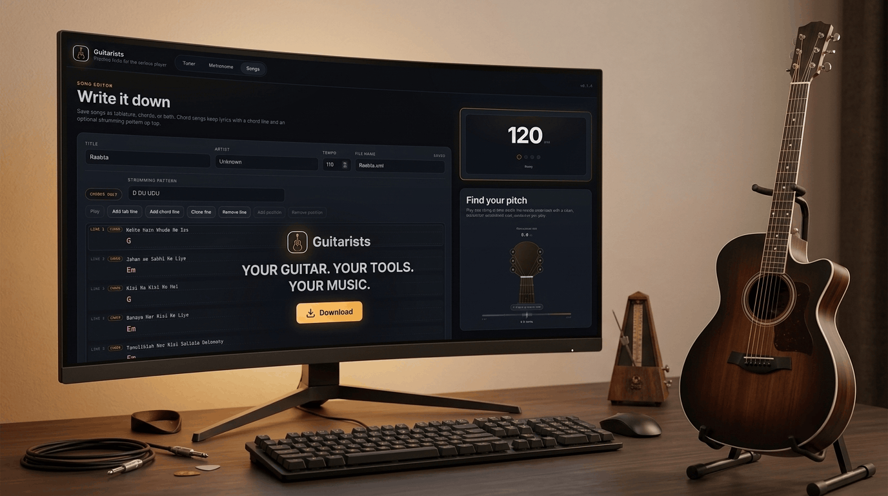

# Guitarists - Your Guitar. Your Tools. Your Music.

> **Open Source · Offline First · Cross Platform**

---

## Everything a Guitarist Needs. Nothing They Don't.

**Guitarists** is a lightweight, all-in-one desktop toolkit designed for guitar players of every skill level. Whether you are tuning up, practicing your rhythm, or capturing your next song idea before it fades, **Guitarists** provides a clean, focused workspace right on your desktop.

* **No subscriptions.**
* **No forced accounts or logins.**
* **No cloud dependencies.**
* **100% free and open-source.**

---

## Your Complete Guitar Toolkit, All in One Place

Stop switching between browser tabs, bloatware DAWs, and phone apps. Focus entirely on playing, practicing, and songwriting.

### 01. Precise Guitar Tuner
Get in tune quickly and accurately using real-time microphone pitch detection.
* **Automatic Note Detection:** Instantly identifies the string and note you are playing.
* **Standard Tuning:** Tuned specifically for standard E A D G B E guitar pitch ranges.
* **Visual Pitch Feedback:** Displays exact frequency (Hz) and cents deviation for precise tuning.

### 02. Configurable Metronome
Develop tight timing, solid rhythm, and speed consistency.
* **Flexible Tempo:** Easily adjust BPM and time signatures on the fly.
* **Subdivisions & Accents:** Customize beat subdivisions and accent downbeats for complex meters.
* **Tap Tempo:** Tap along to quickly detect and set the BPM of any song.

### 03. Songs & Tablature Editor
Capture riffs, solos, and song structures easily with a streamlined notation layout.
* **6-String Interactive Tab:** Input fret numbers (0–24) directly using your keyboard.
* **Expressive Techniques:** Add slides, rests, and pauses.
* **Lyrics Integration:** Align lyrics directly above corresponding tablature measures.
* **Live Playback:** Hear your tabs played back in real-time with tempo control and active note highlighting.

### 04. Chords & Songwriting Notebook
Keep your song lyrics, chord charts, and strumming patterns organized in one place.
* Pair chords inline with lyrics for easy sheet music generation.
* Save and structure custom strumming patterns (U/D notation).
* Combine rich text songwriting with embedded tablature snippets.

---

## Built for Musicians, Not Complexity

You don’t need an overly complex Digital Audio Workstation just to tune your instrument or jot down a riff.

| Feature | Guitarists | Web Apps & DAWs |
| :--- | :--- | :--- |
| **Offline First** | Works completely without internet | Requires steady connectivity |
| **Privacy First** | No telemetry, zero data collection | Tracks usage and personal data |
| **Data Ownership** | Plain-text XML saved locally | Vendor lock-in & proprietary formats |
| **Performance** | Ultra-lightweight (Go + Wails v3) | Heavy resource utilization |

---

## Download & Compatibility

Guitarists is natively compiled for all major operating systems:

* **Windows:** Windows 10 / 11 (64-bit)
* **Linux:** Ubuntu, Debian, Fedora, Arch (64-bit)
* **macOS:** Intel (x86\_64) & Apple Silicon (M1/M2/M3/M4)

| | |
|:------:|:------:|
|  |  |

---

## Open Source & Community Driven

Built with **Go** and **Wails v3**, Guitarists is built on the belief that fundamental creative tools should be free, fast, and accessible to everyone.

* **GitHub Repository:** [github.com/shakeelansari63/Guitarists](https://github.com/shakeelansari63/Guitarists)
* **Report Issues / Request Features:** Submit issues or pull requests directly on GitHub.
